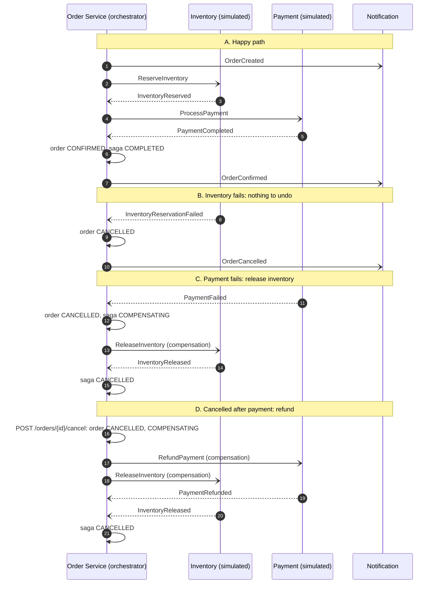

# Sequence diagrams (Mermaid source; PNG renderings are `sequence_event_flow.png` and `sequence_saga.png`)

## 1. OrderCreated event flow

```mermaid
sequenceDiagram
    autonumber
    participant C as Client
    participant O as Order Service (API)
    participant ODB as Order DB (+outbox)
    participant R as Outbox relay (thread)
    participant MQ as RabbitMQ
    participant N as Notification Service
    participant NDB as Notification DB

    C->>O: POST /orders (X-Correlation-ID)
    O->>O: validate request
    O->>ODB: ONE transaction: order + saga + outbox(OrderCreated, ReserveInventory)
    O-->>C: 201 Created (returned now; does not wait for broker or consumer)
    O-)R: wake (non-blocking)
    R->>ODB: read unpublished outbox rows
    R->>MQ: publish order.created (persistent)
    MQ-->>R: publisher confirm
    R->>ODB: mark row published
    MQ->>N: deliver (notification.order_events)
    N->>NDB: ONE transaction: processed_events(event_id) + notification
    N->>N: log "event processed successfully" (same correlation_id)
    N-->>MQ: basic_ack
    Note over N,MQ: transient error: retry with backoff, then NACK to dead-letter queue
```

## 2. Order saga (orchestrated) with compensation


